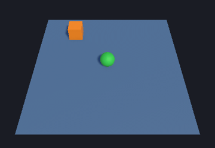

# BLM5026 Bilgisayar Oyunlarında Yapay Zeka: Haftalık Uygulamalar

**Öğrenci:** Veysel Uğurlu · **Program:** Bursa Teknik Üniversitesi, Bilgisayar Mühendisliği Yüksek Lisans
**Ders:** BLM5026 Bilgisayar Oyunlarında Yapay Zeka (Doç. Dr. İzzet Fatih Şentürk)
**Ortam:** Unity 6.3 LTS (6000.3.25f1) · URP · Input System · ML-Agents 4.1.0 · Python 3.10.12

Bu depo dersin haftalık uygulamalarını içerir. Her hafta ayrı bir `feature/...` dalında geliştirilir ve Pull Request ile `main` dalına birleştirilir.

| Rapor | Hafta | Konu | Dal | Klasör |
|---|---|---|---|---|
| **Rapor 4** | 5 | Unity ML-Agents: kurulum, Basic örneği, RollerAgent (kendi RL ortamımız) | `feature/week05-ml-agents` | [docs/week05](docs/week05/README.md) |

*1. hafta için rapor istenmediğinden rapor numaraları haftadan bir eksiktir (Hafta 5 = Rapor 4).*

---

## Rapor 4 (Hafta 5): Unity ML-Agents ile pekiştirmeli öğrenme



Yeşil top (ajan) turuncu küpe (hedef) ulaşmayı deneme yanılma ile öğreniyor. Ajan hedefe ulaşınca +1 puan alıyor; masadan düşerse ya da süre dolarsa deneme puansız bitiyor. Eğitimde PPO algoritması kullanıldı ve eğitilen sinir ağı ONNX dosyası olarak Unity'de, Python olmadan çalıştırıldı.

| | Sonuç |
|---|---|
| Sunu 1: Kurulum + Basic | ML-Agents 4.1.0 kaynaktan kuruldu, Basic örneği teorik en iyi ödüle (0.93) ulaştı |
| Sunu 2: RollerAgent | Ortam sıfırdan kuruldu. Eğitilmiş PPO aynı 200 başlangıç koşulunda **%93.2 ± 11.4** başarı aldı (3 seed); rastgele politika %21.5 |
| Challenge: ablasyon | Göreli gözlem (Deney B), yeni başlangıç konumlarında başarıyı **%48 → %96.5** çıkardı |

Ayrıntılı rapor: **[docs/week05/README.md](docs/week05/README.md)** · Word raporu: [docs/week05/Rapor4_Hafta5_ML-Agents.docx](docs/week05/Rapor4_Hafta5_ML-Agents.docx)

### Projeyi açma

1. Depoyu klonlayın ve **Unity Hub → Add project from disk** ile depo kök klasörünü açın (Unity 6000.3.x).
2. Package Manager `com.unity.ml-agents 4.1.0` paketini otomatik indirir.
3. `Assets/MLAgentsCourse/Scenes/RollerBallInference.unity` sahnesini açıp **Play** deyin. Eğitilmiş model yeşil topu hedefe götürür.
4. `RollerBallTraining.unity` sahnesinde Behavior Parameters → Behavior Type = **Heuristic Only** yaparsanız topu **WASD / ok tuşları** ile kendiniz sürebilirsiniz.

### Python ortamı (eğitim için)

```bash
# Python 3.10.12 (conda veya venv)
conda create -n mlagents41 python=3.10.12 && conda activate mlagents41
git clone https://github.com/Unity-Technologies/ml-agents.git
cd ml-agents && git checkout ee0a08ccae597094003844d0121317f9790a1676   # ML-Agents 4.1.0 kaynağı
python -m pip install ./ml-agents-envs
python -m pip install ./ml-agents
mlagents-learn --help
```

### Eğitim

```bash
# Editor ile (sunudaki yol): komutu çalıştırın, "Start training by pressing the Play button" mesajından sonra Play'e basın
mlagents-learn config/rollerball_2026.yaml --run-id=RollerBall_U63_01

# Build ile (bu raporda kullanılan yol: hızlı, grafiksiz, 9 paralel alan)
mlagents-learn config/rollerball_2026.yaml --run-id=RB_Absolute8_s1 --env=Builds/RollerBall/RollerBall.exe \
  --no-graphics --seed=1 --time-scale=20 --env-args -obsMode Absolute8 -areas 9

tensorboard --logdir results
```

Tüm deneyler: `bash tools/run_experiments.sh` · Değerlendirme: `python tools/evaluate.py ...` · Grafikler: `python tools/plot_training.py`

### Depo yapısı

```
Assets/MLAgentsCourse/
  Scripts/   RollerBallAgent.cs (ajan), TrainingAreaReplicator.cs, FrameRecorder.cs, CourseArgs.cs
  Editor/    RollerBallSceneBuilder.cs (sahne + build otomasyonu, menü: "ML Agents Course")
  Scenes/    RollerBallTraining.unity, RollerBallInference.unity
  Models/    Eğitilmiş ONNX modelleri
  Materials/
config/      PPO yapılandırmaları (YAML)
tools/       Deney, değerlendirme ve grafik scriptleri (Python)
docs/week05/ Rapor, görseller, ham sonuçlar
```

### Yapay zekâ kullanımı

Ders politikasına uygun olarak belirtiyorum: Kurulum, kod iskeleti, deney scriptleri ve rapor taslağı için bir LLM asistanından (Claude) yardım alındı. Ödül tanımı, gözlem tasarımı ve deney kurgusu sunulardaki referans çözüme dayanır. Kodun tamamı okundu, çalıştırıldı ve test edildi; her satırın gerekçesi raporda açıklanmıştır.
