# Rapor 4 (Hafta 5): Unity ML-Agents ile Pekiştirmeli Öğrenme

**BLM5026 Bilgisayar Oyunlarında Yapay Zeka** · Veysel Uğurlu · Unity 6.3 LTS · ML-Agents 4.1.0 · PPO

> Word raporu: [Rapor4_Hafta5_ML-Agents.docx](Rapor4_Hafta5_ML-Agents.docx)

 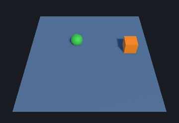

*Sol: eğitilmiş ajan (baseline, 8 gözlem). Sağ: Deney B modeli; ajan her seferinde rastgele bir yerden başlıyor.*

---

## 1. Bu hafta ne yaptık? (kısa özet)

Bir oyun karakterine bir işi **kuralları kodlamadan, deneme yanılma ile öğrettik.** Yeşil top (ajan), turuncu küpe (hedef) ulaşınca +1 puan alıyor. Masadan düşerse ya da 500 adımda hedefe varamazsa puan almadan deneme bitiyor. Ajan başlangıçta rastgele hareket ediyor. Yaklaşık 200.000 adımlık deneyimden sonra, nereye kuvvet uygularsa ödül alacağını öğreniyor.

| Ne | Sonuç |
|---|---|
| Sunu 1: kurulum | Unity 6000.3.25f1, ML-Agents 4.1.0, Python 3.10.12, kaynak commit `ee0a08c` doğrulandı ([manifest](environment_manifest.md)) |
| Sunu 1: Basic örneği | PPO 12.000 adımda teorik en iyi ödüle (0.93) ulaştı |
| Sunu 2: RollerAgent | Kendi RL ortamımız sıfırdan kuruldu, eğitildi, ONNX modeli Unity'de çalıştırıldı |
| Değerlendirme | Eğitimsiz rastgele politika **%21.5**, eğitilmiş PPO **%93.2 ± 11.4** (3 seed), en iyi seed **%100** |
| Ablasyon (Deney B) | Göreli gözlem, yeni başlangıç noktalarında başarıyı **%48.0 → %96.5** çıkardı |

## 2. Temel kavramlar (hiç bilmeyenler için)

| Kavram | RollerBall'daki karşılığı |
|---|---|
| **Ajan (Agent)** | Yeşil top. Karar veren taraf |
| **Ortam (Environment)** | Zemin, hedef, fizik. Ajanın içinde yaşadığı dünya |
| **Gözlem (Observation)** | Ajanın her adımda "gördüğü" 8 sayı: hedefin konumu (3), kendi konumu (3), hızı (2) |
| **Aksiyon (Action)** | Ajanın her adımda verdiği 2 sayı: X ve Z yönünde ne kadar kuvvet uygulanacağı (−1..+1) |
| **Ödül (Reward)** | Hedefe ulaşınca +1. Öğrenmenin tek yön göstericisi |
| **Episode** | Bir deneme: başla → hareket et → başar / düş / süre dolsun → baştan başla |
| **Politika (Policy)** | Gözlemi aksiyona çeviren sinir ağı. Eğitilen şey budur |
| **PPO** | Politikayı küçük ve güvenli adımlarla iyileştiren pekiştirmeli öğrenme algoritması |
| **ONNX** | Eğitilmiş sinir ağının dosya hali. Unity bunu Python olmadan çalıştırır (*inference*) |

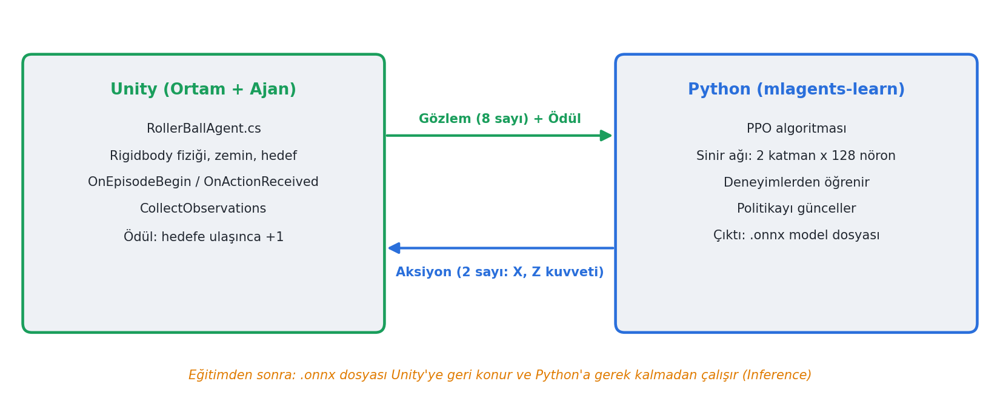

## 3. Sunu 1: Kurulum ve Basic örneği

**Advanced installation** uygulandı: Resmi repo klonlandı ve 4.1.0 kaynağına sabitlendi. Python paketleri aynı kaynaktan, önce `ml-agents-envs` sonra `ml-agents` sırasıyla kuruldu.

```bash
git clone https://github.com/Unity-Technologies/ml-agents.git
cd ml-agents && git checkout ee0a08ccae597094003844d0121317f9790a1676
python -m pip install ./ml-agents-envs
python -m pip install ./ml-agents
```

**Aktivite 1, environment manifest:** [environment_manifest.md](environment_manifest.md). Not: Python trainer sürümü tahmin edilmedi, kaynaktan okundu: `1.2.0.dev0`. Proje Unity Package Registry'deki `com.unity.ml-agents 4.1.0` paketini kullanıyor. Bu paketin `Runtime/` klasörünün, sabitlenen kaynak commit'iyle birebir aynı olduğu `diff` ile doğrulandı (yalnızca satır sonları farklı).

**Aktivite 2, ilk eğitimin teşhisi:** Basic sahnesi build edildi ve `config/ppo/Basic.yaml` ile eğitildi ([log kanıtı](data/basic_training_evidence.txt)):
1. `Connected to Unity environment with package version 4.1.0 and communication version 1.5.0`
2. Adım ilerlemesi: `Step: 2000 … Mean Reward: 0.129` → `Step: 12000 … Mean Reward: 0.925`
3. `results/Basic_U63_01/` altında `Basic.onnx`, checkpoint, TensorBoard event dosyası ve `configuration.yaml` üretildi

Basic'te ajan 10. konumda başlıyor. 7'deki küçük hedef +0.1, 17'deki büyük hedef +1 veriyor ve her adım −0.01. En iyi strateji 7 adım sağa gitmek: 1 − 0.07 = **0.93**. PPO tam bu değere yakınsadı.

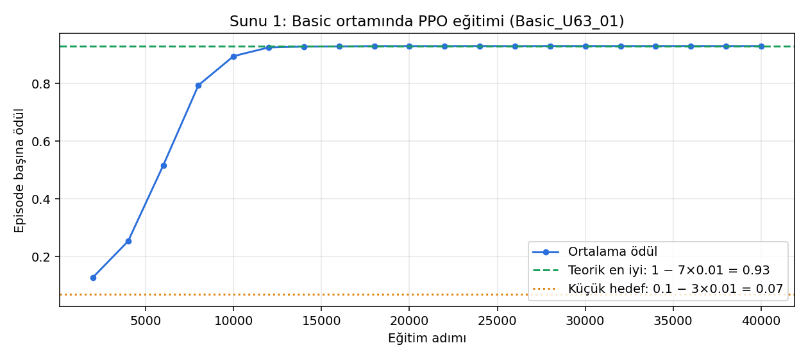

## 4. Sunu 2: RollerAgent ortamı

### 4.1 Sahne

```
TrainingArea
 ├─ Floor        (Plane 10x10, MeshCollider)
 ├─ Target       (Cube, turuncu, local (3, 0.5, 3), BoxCollider)
 └─ RollerAgent  (Sphere, yeşil, local (0, 0.5, 0))
      Rigidbody · Behavior Parameters · Decision Requester · RollerBallAgent.cs
```

| | |
|---|---|
| 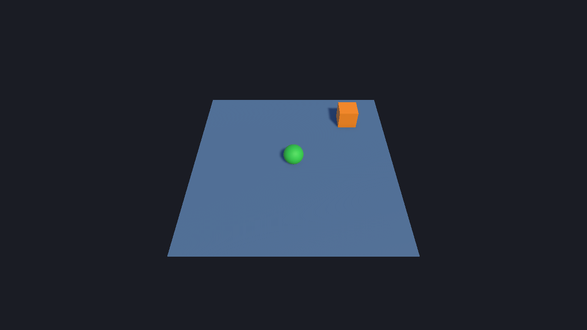 | 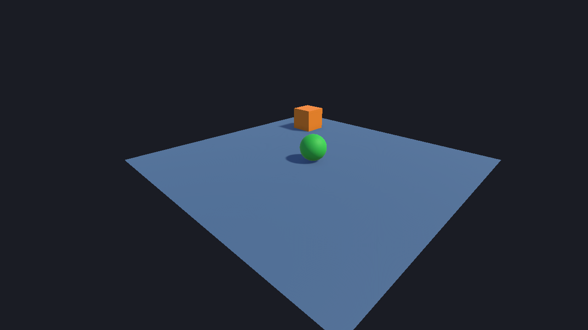 |

Sahne, [RollerBallSceneBuilder.cs](../../Assets/MLAgentsCourse/Editor/RollerBallSceneBuilder.cs) ile üretiliyor (menü: **ML Agents Course → 1. Build RollerBall Training Scene**). Böylece herkes aynı sahneyi tek tıkla elde ediyor.

### 4.2 Ajan kodu: [RollerBallAgent.cs](../../Assets/MLAgentsCourse/Scripts/RollerBallAgent.cs)

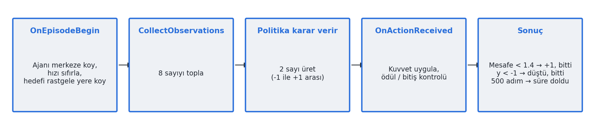

| Metot | Ne yapıyor | Neden |
|---|---|---|
| `OnEpisodeBegin` | Ajanı (0, 0.5, 0)'a koyar, `linearVelocity` ve `angularVelocity` değerlerini sıfırlar, hedefi rastgele yere koyar (ajanın üstüne gelmeyecek şekilde) | Sadece konumu sıfırlarsak önceki denemenin hızı yeni denemeye taşınır. Hedefin yerini değiştirmek ajanın tek bir rotayı ezberlemesini engeller |
| `CollectObservations` | 8 sayı: `target.localPosition`, `transform.localPosition`, `velocity.x`, `velocity.z` | **Local** koordinat: alan kopyalandığında her kopya aynı sayıları görür |
| `OnActionReceived` | `AddForce(new Vector3(a0, 0, a1) * 10)`. Mesafe < 1.4 ise `SetReward(1)` + `EndEpisode()`, y < −1 ise `EndEpisode()` | Aksiyon bir **kuvvet**, konum değil. Momentumu fizik motoru hesaplıyor |
| `Heuristic` | WASD / ok tuşları → 2 aksiyon (`Keyboard.current`, yeni Input System) | Eğitimden önce ortamın doğru çalıştığını elle test etmek için |

**Aktivite 4, Heuristic testi:** Behavior Type = Heuristic Only yapılıp top WASD ile sürüldü. Hareket, hedefe ulaşınca başarı ve sıfırlanma, düşünce sıfırlanma senaryolarının üçü de doğru çalıştı.

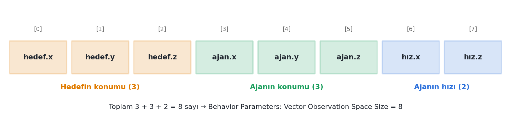

**Behavior Parameters (C#, YAML ve model arasındaki sözleşme):** Behavior Name `RollerBall_U63` · Vector Observation Space Size `8` · Continuous Actions `2` · Discrete Branches `0` · Decision Period `1` · Max Step `500`.

### 4.3 Eğitim: [config/rollerball_2026.yaml](../../config/rollerball_2026.yaml)

Sunudaki PPO ayarları değiştirilmeden kullanıldı: batch 128, buffer 2048, lr 3e-4, β 5e-3, ε 0.2, λ 0.95, 3 epoch, 2×128 ağ, γ 0.99, `max_steps 200000`.

```bash
mlagents-learn config/rollerball_2026.yaml --run-id=RB_Absolute8_s1 --env=Builds/RollerBall/RollerBall.exe \
  --no-graphics --seed=1 --time-scale=20 --env-args -obsMode Absolute8 -areas 9
```

`-areas 9` seçeneği, [TrainingAreaReplicator.cs](../../Assets/MLAgentsCourse/Scripts/TrainingAreaReplicator.cs) ile sahnedeki alanı 9 kopyaya çıkarıyor. Bu yalnızca eğitimi hızlandırıyor; toplam adım bütçesi aynı kalıyor. Bir eğitim CPU üzerinde yaklaşık 4–13 dakika sürdü (ilki, aynı anda Basic build alındığı için yavaştı).

### 4.4 Inference

Eğitim sonunda üretilen ONNX dosyası `Assets/MLAgentsCourse/Models/` klasörüne kopyalandı. Sonra Behavior Parameters → **Model** alanına atandı ve **Behavior Type = Inference Only** yapıldı. Sonuç: [RollerBallInference.unity](../../Assets/MLAgentsCourse/Scenes/RollerBallInference.unity). Bu sahnede Play'e basınca ajan Python olmadan hedefe gidiyor.

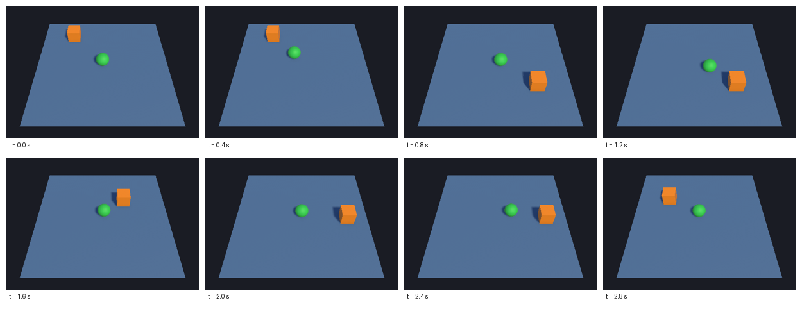

### 4.5 Unity Editor'dan görüntüler

| | |
|---|---|
| 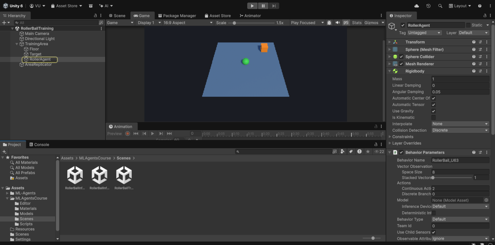 | 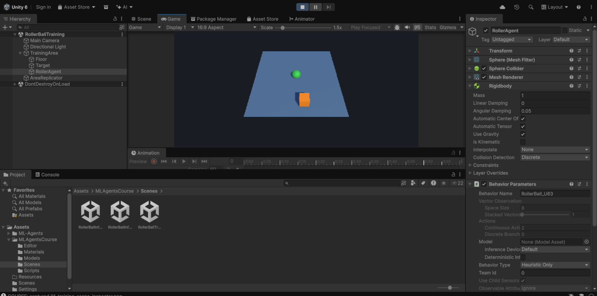 |
| *RollerBallTraining: Hierarchy ve Behavior Parameters (Space Size 8, Continuous Actions 2)* | *Heuristic Only: top Play modunda klavye ile sürülüyor* |
| 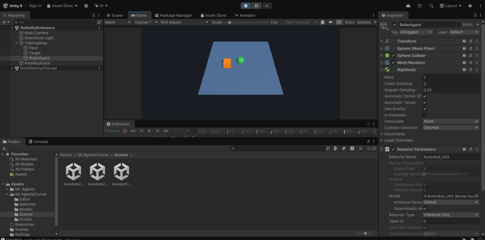 | 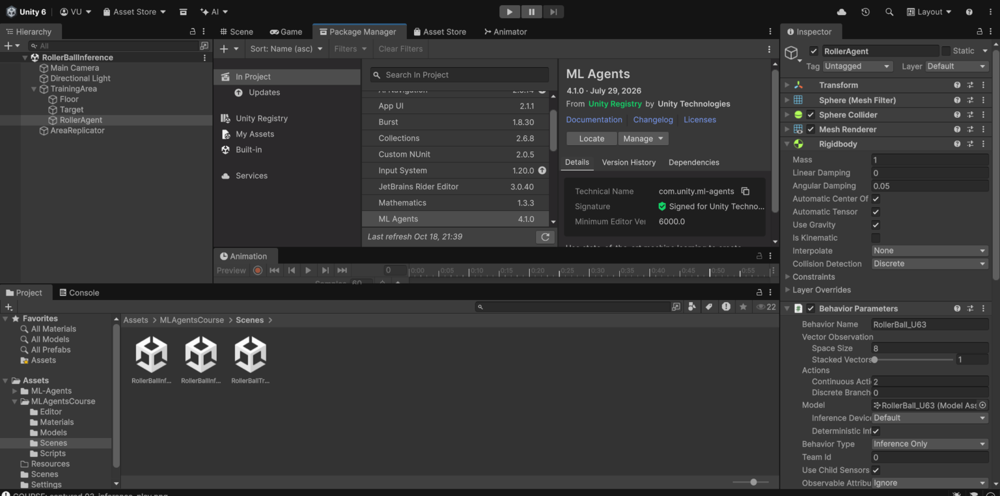 |
| *Inference Only: Model = RollerBall_U63 (eğitilmiş ONNX)* | *Package Manager: ML Agents 4.1.0* |
| 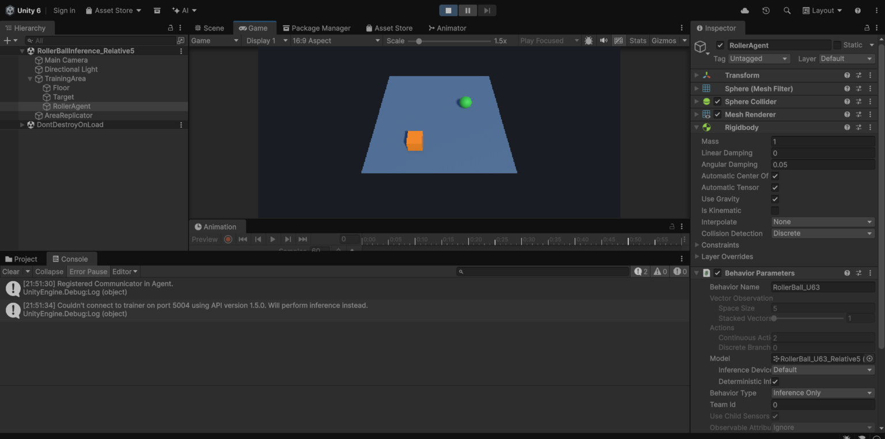 | |
| *Deney B sahnesi çalışırken Console: hata ve uyarı yok* | |

Bu görüntüler [ReportScreenshots.cs](../../Assets/MLAgentsCourse/Editor/ReportScreenshots.cs) ile Unity Editor'ın kendisinden alındı (menü: **ML Agents Course → 5. Capture Report Screenshots**).

## 5. Öğrenmeyi nasıl değerlendirdik?

Sunu 2'nin önerdiği deney disiplini uygulandı:
- **3 seed:** her yapılandırma 3 farklı rastgele tohumla eğitildi.
- **Aynı bütçe:** her eğitim 200.000 adım.
- **Aynı başlangıç koşulları:** her politika, Unity'ye aynı seed (`12345`) verilerek **aynı 200 hedef konumunda** test edildi ([evaluate.py](../../tools/evaluate.py)).
- **Karşılaştırma:** eğitimsiz rastgele politika ve kural tabanlı bir kontrolcü ile. Kural tabanlı kontrolcü klavye heuristic'inin otomatik karşılığı olarak kullanıldı ve hedefe doğru iten, hız ile fren yapan bir PD denetleyicisi olarak tasarlandı.

| Politika | Başarı % | Düşme % | Süre doldu % | Ort. episode (adım) | Hedefe varış (s) |
|---|---|---|---|---|---|
| Rastgele (eğitimsiz) | 21.5 | 69.0 | 9.5 | 308.3 | 3.97 |
| Kural tabanlı kontrolcü | 100.0 | 0.0 | 0.0 | 40.1 | 0.80 |
| **PPO baseline (8 gözlem)** | **93.2 ± 11.4** | 6.8 | 0.0 | 45.7 | 0.77 |
| PPO Deney A (6, hızsız) | 100.0 ± 0.0 | 0.0 | 0.0 | 35.9 | 0.72 |
| PPO Deney B (5, göreli) | 100.0 ± 0.0 | 0.0 | 0.0 | 33.9 | 0.68 |

*Ajan merkezden başlıyor, eğitimdeki gibi. PPO satırları 3 seed'in ortalaması ± standart sapması, her seed için 200 episode. 1 adım = 0.02 s.*

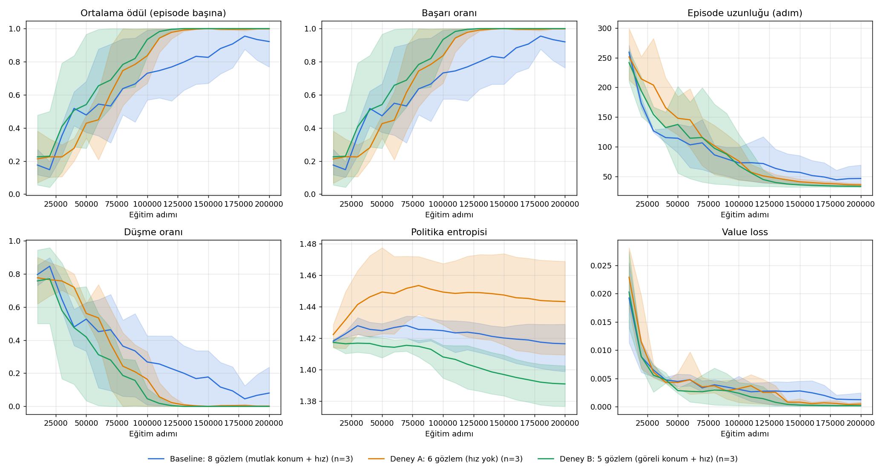
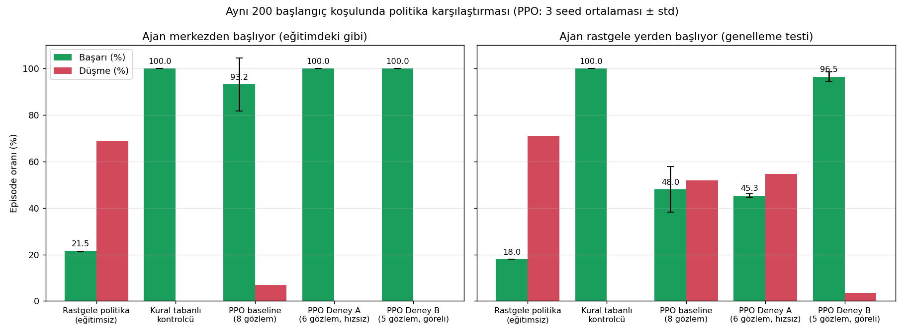

**Baseline'ın seed'lere göre sonuçları:** %99.5 / %80.0 / %100. Seed 2'nin eğitimi 200.000 adımda %77'de kaldı. Seed 1 %90'a 160.000 adımda, seed 3 ise 70.000 adımda ulaştı. Tek bir eğitimle "öğrendi" ya da "öğrenmedi" demek yanıltıcı olurdu.

## 6. Challenge: gözlem ablasyonu

| Deney | Gözlem | Boyut | Hipotez | Sonuç |
|---|---|---|---|---|
| Baseline | hedef konumu, ajan konumu, hız (x, z) | 8 | – | %93.2 ± 11.4 |
| **A** | hız çıkarıldı | 6 | Fren yapamaz, hedefi geçer, daha yavaş öğrenir | Başarı düşmedi (%100). %90'a 80–120 bin adımda ulaştı. **Entropi daha yüksek kaldı** (politika daha kararsız) |
| **B** | hedef − ajan (göreli) + hız | 5 | Konumdan bağımsız, daha iyi genelleşir | Merkezden başlarken %100. **Rastgele başlangıçta %96.5 ± 2.0** (baseline %48.0) |

**Genelleme testi:** Ajan, eğitimde hiç görmediği rastgele noktalardan başlatıldı.

| Politika | Başarı % | Düşme % |
|---|---|---|
| Kural tabanlı | 100.0 | 0.0 |
| PPO baseline (8) | 48.0 ± 9.8 | 52.0 |
| PPO Deney A (6) | 45.3 ± 0.8 | 54.7 |
| **PPO Deney B (5, göreli)** | **96.5 ± 2.0** | 3.5 |

**Yorum:**
- **Deney A:** Hız bilgisi bu görevde kritik çıkmadı. Ajan her 0.02 saniyede bir yeniden karar verdiği için, kendi hareketini bir sonraki gözlemde zaten düzeltebiliyor. Görev "hedefte durmayı" değil sadece "dokunmayı" istediğinden fren de gerekmiyor. Yine de entropinin yüksek kalması, politikanın daha belirsiz olduğunu gösteriyor. Durmayı gerektiren bir görevde bu fark büyüyebilir.
- **Deney B:** Mutlak konumla eğitilen ajan hep merkezden başladığı için yalnızca "merkezden hedefe giden yolları" görmüş. Başka bir yerden başladığında ezberlediği durumların dışına çıkıyor ve yarısında düşüyor. Göreli gözlemde "hedef 2 m sağımda" durumu masanın neresinde olursa olsun aynı sayılarla ifade ediliyor. Böylece öğrenilen davranış her yere taşınabiliyor.
- **Bedeli:** Göreli gözlem ajanın masa kenarını bilmesini engelliyor; kalan %3.5'lik düşmenin bu eksiklikten kaynaklandığı düşünülüyor (ayrıca test edilmedi). Bir sonraki adım, göreli konuma "kenara uzaklık" gibi bir bilgi eklemek olabilir.

## 7. Dosyalar

| Dosya | Açıklama |
|---|---|
| [RollerBallAgent.cs](../../Assets/MLAgentsCourse/Scripts/RollerBallAgent.cs) | Ajan: gözlem, aksiyon, ödül, heuristic, TensorBoard metrikleri |
| [RollerBallSceneBuilder.cs](../../Assets/MLAgentsCourse/Editor/RollerBallSceneBuilder.cs) | Sahne, build ve inference otomasyonu |
| [config/rollerball_2026.yaml](../../config/rollerball_2026.yaml) | PPO ayarları (sunudaki gibi) |
| [config/basic_short.yaml](../../config/basic_short.yaml) | Basic için resmi YAML (yalnızca `max_steps` 40.000) |
| [tools/](../../tools) | Deney (`run_experiments.sh`), değerlendirme (`evaluate.py`, `run_evaluation.sh`), grafikler |
| [data/](data) | Ham değerlendirme sonuçları (JSON), eğitim özeti, Basic log kanıtı |
| `Assets/MLAgentsCourse/Models/` | `RollerBall_U63.onnx` (baseline, seed 3), `RollerBall_U63_Relative5.onnx` (Deney B, seed 1) |

## 8. Kaynaklar

- Unity ML-Agents 4.1 (Unity 6000.3 paket listesi) ve GitHub deposu: https://github.com/Unity-Technologies/ml-agents
- Ders sunuları: *ML-Agents Sunu 1: Advanced Kurulum* ve *Sunu 2: Custom RollerAgent* (Unity 6.3)
- Schulman vd., *Proximal Policy Optimization Algorithms*, arXiv:1707.06347, 2017
- Juliani vd., *Unity: A General Platform for Intelligent Agents*, arXiv:1809.02627, 2018
- Millington, *AI for Games*, 3. baskı, CRC Press, 2019
